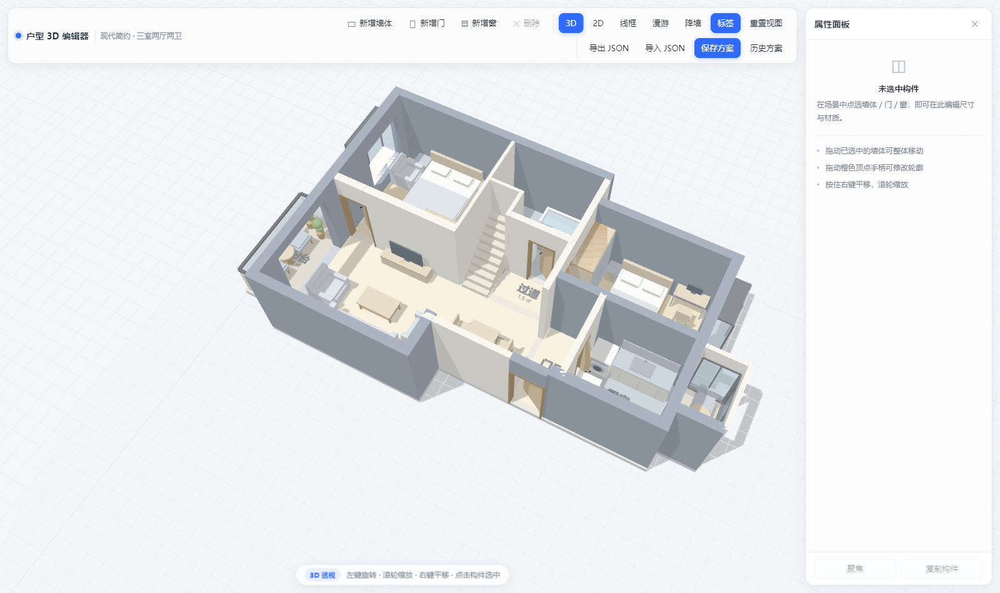
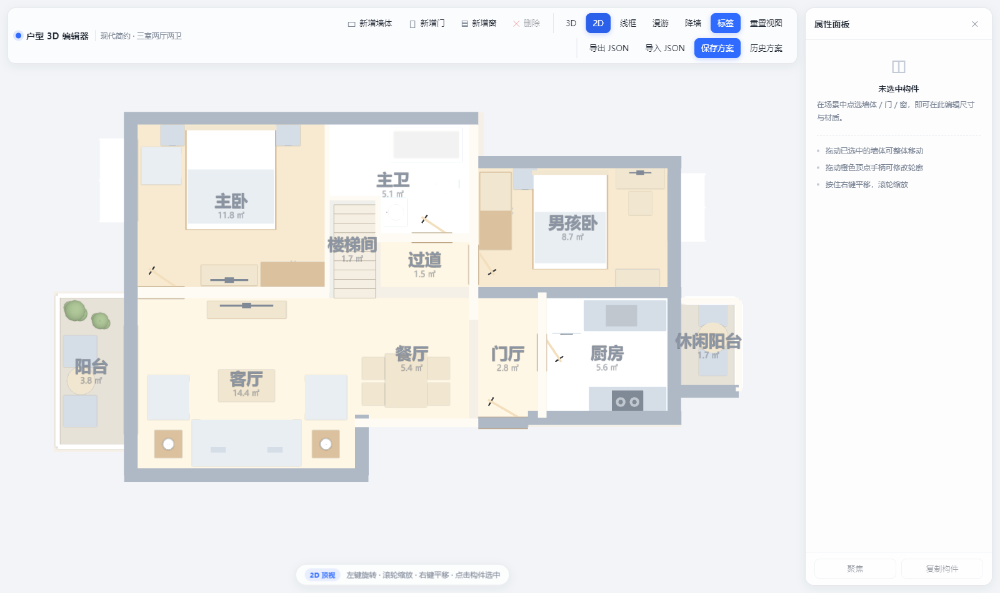
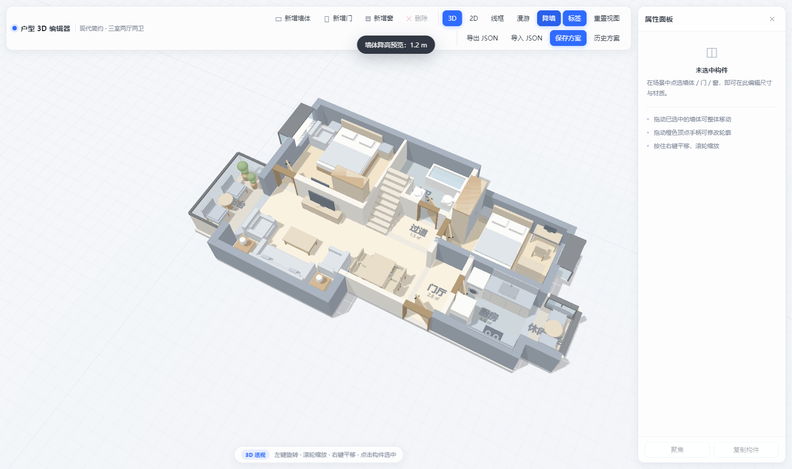
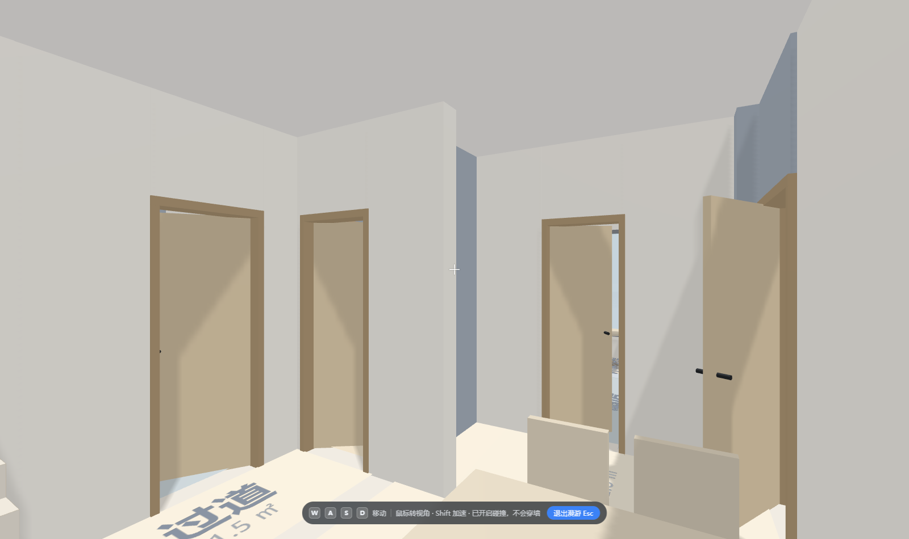

# 户型 3D 编辑器（Three.js 白模）

> 由上传的户型平面图反推生成的可独立运行、可交互编辑的三维户型可视化项目。
> 原生 Three.js + OrbitControls，**无构建工具、无外部网络资源**，双击 `index.html` 即可运行。
>
> **v1.1（2026-11-01）**：① 按图纸补齐 42 件家具（床 / 沙发 / 餐桌 / 橱柜 / 洁具 / 绿植 …）；
> ② 新增**第一人称漫游**（WASD 行走 + 圆-OBB 碰撞检测，人不会穿墙穿家具）。

| 3D 透视（含家具） | 2D 正交平面图 |
| --- | --- |
|  |  |

| 降墙预览（1.2 m） | 第一人称漫游 |
| --- | --- |
|  |  |

---

## 1. 目录结构

```
src/3d-house-editor/
├── index.html        # 入口页面（可 file:// 直接打开，也可 iframe 嵌入 Hermes 后台）
├── main.js           # 户型数据模型 + Three.js 场景/几何构建（唯一数据源）
├── editor.js         # 编辑器核心：拾取、拖拽、属性面板、增删、视图、JSON、桥接
├── style.css         # 顶栏 / 属性面板 / 按钮 / Toast / Modal 样式（白模浅色系）
├── readme.md         # 本文件
└── vendor/
    ├── three.min.js      # three.js UMD 构建（本地化，不走 CDN）
    └── OrbitControls.js  # 控制器（挂载到 THREE.OrbitControls）
```

配套归档文档：`docs/archive/3d-house-asset.md`（资产编号 HS-3D-2026-001）

---

## 2. 运行方式

| 方式 | 操作 | 说明 |
| --- | --- | --- |
| 本地直接打开 | 双击 `index.html` | 经典 `<script>` 引入，无需 http 服务；`fetch` 源码定位会静默降级 |
| 本地静态服务 | `npx serve .` 后访问 | 全部功能可用（含构件源码行号定位） |
| Hermes 后台 | `<iframe src="http://<host>:8090/3d-house-editor/index.html">` | 页面会识别 `window.parent !== window`，自动加 `body.is-embedded` 紧凑排版 |

> 嵌入示例
> ```html
> <iframe src="/3d-house-editor/index.html"
>         style="width:100%;height:calc(100vh - 48px);border:0;border-radius:12px"
>         allow="fullscreen"></iframe>
> ```

---

## 3. 操作手册

### 3.1 鼠标 / 触摸
| 操作 | 效果 |
| --- | --- |
| 左键拖动空白处 | 旋转视角（2D 顶视下为平移） |
| 滚轮 | 缩放 |
| 右键拖动 | 平移场景 |
| 单击构件 | 选中（墙体 / 门 / 窗 / 栏板 / 房间地面 / 楼梯 / **家具**） |
| 拖动**已选中**构件 | 整体平移（0.05 m 吸附） |
| 拖动橙色球手柄 | 修改墙体（门窗洞口）轮廓端点 |
| 点击空白 | 取消选中 |

### 3.2 快捷键
`W` 新增墙体 · `D` 新增门 · `N` 新增窗 · `Del/Backspace` 删除选中 · `Esc` 取消选中 · `R` 重置视图 · `F` 聚焦选中

> 漫游状态下快捷键由漫游接管：`WASD / ↑↓←→` 移动、`Shift` 加速、`Esc` 退出漫游。

### 3.2.1 第一人称漫游（不穿模）
| 操作 | 效果 |
| --- | --- |
| 点工具栏「漫游」 | 从门厅进入第一人称；视高 1.62 m，FOV 68° |
| `W A S D` / 方向键 | 前后左右走（3.0 m/s，`Shift` ×1.9） |
| 移动鼠标 | 转身（优先 Pointer Lock；iframe 未授权时自动降级为**按住左键拖动**转视角） |
| `Esc` 或 HUD 上的「退出漫游」 | 退出并恢复进入前的 3D 视角 |

碰撞实现（`editor.js → walkResolve`）：把墙体实心段、栏板、楼梯、家具换算成 XZ 平面上的
**有向包围盒（OBB）**，把相机水平位置当作半径 **0.30 m** 的圆，逐帧做圆-矩形推挤，迭代 3 次收敛。
- 门窗洞口处墙体本身没有实心段，所以**门洞天然可通行**；
- 窗户下方的窗台墙仍按实心处理，**不会穿窗而出**；
- 家具按 `solid` 字段参与碰撞（地毯等不挡人）。

### 3.3 工具栏
| 按钮 | 功能 |
| --- | --- |
| 新增墙体 / 新增门 / 新增窗 | 墙体默认建在当前视角中心；门/窗需**先选中一面墙**，会挂到该墙上 |
| 删除 | 删除当前选中构件 |
| 3D / 2D | 3D 透视（PerspectiveCamera）/ 2D 顶视（**OrthographicCamera** 正投影，标准平面图） |
| 线框 | 实体 ↔ 结构线框（只画真实棱边，不画三角剖分线；线框模式只表达结构，家具隐藏） |
| 漫游 | 进入 / 退出第一人称漫游（自动切回真实层高、关闭线框、补上顶棚） |
| 降墙 | 墙体高度 2.8 m ↔ 1.2 m，便于俯视检查布局 |
| 标签 | 显示/隐藏房间名+面积 |
| 重置视图 | 回到默认 3D 视角（2D 下会先切回 3D） |
| 导出 JSON / 导入 JSON | 下载 / 载入户型方案 |
| 保存方案 | POST 到 Hermes 后端；后端未就绪时自动降级写入 localStorage 历史方案 |
| 历史方案 | 拉取后端列表（失败则读 localStorage），可一键载入 |

### 3.4 属性面板
- **墙体**：名称、长度、厚度、高度、承重/非承重、起点/终点 XZ、材质颜色
- **门**：名称、宽度、高度、开启角度、铰链端、开启方向、坐标、颜色
- **窗**：名称、洞口宽、窗台高、窗高（或通口高）、窗型（普通窗/飘窗/通口）、外挑进深、坐标、颜色
- **家具**：名称、宽、深、高、旋转角（-180°~180°）、中心 X/Z、材质颜色
- **房间**：名称、面积（只读）、地面颜色
- **栏板 / 楼梯**：尺寸类字段
- 面板底部显示 **源码锚点**（`main.js` 中该构件的 `id` 与行号），供 DSH 侧边栏定位

---

## 4. 户型构件清单

### 4.1 墙体（22 段，中心线坐标，单位 m）
> 坐标系：原点取图纸左上角墙体外皮，X 向东（图纸右），Z 向南（图纸下），层高 2.8 m。

| # | id | 名称 | 起点 (x,z) | 终点 (x,z) | 厚度 | 性质 |
| --- | --- | --- | --- | --- | --- | --- |
| 1 | wall-west | 西外墙（主卧/客厅） | 1.52, 0.00 | 1.52, 7.16 | 0.27 | 承重 |
| 2 | wall-north | 北外墙 | 1.39, 0.125 | 8.36, 0.125 | 0.25 | 承重 |
| 3 | wall-boy-north | 男孩卧北外墙 | 8.20, 0.99 | 12.36, 0.99 | 0.24 | 承重 |
| 4 | wall-living-south | 客厅南外墙 | 1.39, 7.16 | 6.20, 7.16 | 0.27 | 承重 |
| 5 | wall-living-east | 客厅东侧短墙 | 6.07, 5.97 | 6.07, 7.16 | 0.27 | 承重 |
| 6 | wall-kitchen-south | 厨房南外墙 | 9.34, 6.03 | 12.36, 6.03 | 0.28 | 承重 |
| 7 | wall-east-north | 东外墙（男孩卧段） | 12.22, 0.87 | 12.22, 3.62 | 0.27 | 承重 |
| 8 | wall-east-pass | 厨房东侧通口墙 | 12.22, 3.62 | 12.22, 5.385 | 0.27 | 承重 |
| 9 | wall-east-south | 东外墙（厨房东南段） | 12.22, 5.385 | 12.22, 6.03 | 0.27 | 承重 |
| 10 | wall-balcony-south | 休闲阳台南墙 | 12.09, 5.51 | 13.49, 5.51 | 0.25 | 承重 |
| 11 | wall-boy-south | 男孩卧南墙/厨房北墙 | 8.20, 3.564 | 12.36, 3.564 | 0.22 | 承重 |
| 12 | wall-dining-south | 餐厅/门厅南墙 | 5.93, 6.13 | 8.36, 6.13 | 0.17 | 非承重 |
| 13 | wall-entry | 入户门洞墙 | 8.36, 6.13 | 9.34, 6.13 | 0.22 | 承重 |
| 14 | wall-kitchen-west | 厨房西墙 | 9.62, 3.56 | 9.62, 6.03 | 0.17 | 非承重 |
| 15 | wall-balcony-east-n | 休闲阳台北窗墙 | 12.36, 3.72 | 13.49, 3.72 | 0.12 | 非承重 |
| 16 | wall-balcony-east-e | 休闲阳台东窗墙 | 13.49, 3.72 | 13.49, 5.51 | 0.12 | 非承重 |
| 17 | wall-hall-west | 主卫东墙/男孩卧西墙 | 8.27, 0.25 | 8.27, 4.10 | 0.18 | 非承重 |
| 18 | wall-master-south | 主卧南墙/客厅北墙 | 1.66, 3.564 | 5.43, 3.564 | 0.22 | 非承重 |
| 19 | wall-master-east | 主卧东墙（轻质） | 5.386, 0.25 | 5.386, 3.564 | 0.10 | 非承重 |
| 20 | wall-bath-mid | 主卫/楼梯隔墙 | 5.34, 1.70 | 6.44, 1.70 | 0.09 | 非承重 |
| 21 | wall-stair-east | 楼梯东隔墙 | 6.39, 1.67 | 6.39, 2.573 | 0.11 | 非承重 |
| 22 | wall-bath-south | 主卫南墙 | 6.34, 2.48 | 8.27, 2.48 | 0.18 | 非承重 |

### 4.2 门（5 樘）
| id | 名称 | 洞口宽 | 铰链端 | 开启方向 |
| --- | --- | --- | --- | --- |
| door-master | 主卧门 | 0.92 m | 终点（x=2.58） | 向北开入主卧 |
| door-bath | 主卫门 | 0.80 m | 终点（x=7.85） | 向北开入主卫 |
| door-boy | 男孩卧门 | 0.79 m | 起点（z=2.62） | 向东开入男孩卧 |
| door-kitchen | 厨房门 | 0.74 m | 起点（z=4.374） | 向东开入厨房 |
| door-entry | 入户门 | 0.98 m | 终点（x=9.34） | 向北开入门厅 |

### 4.3 窗 / 通口（6 处）
| id | 名称 | 类型 | 洞口 | 窗台 / 洞顶 |
| --- | --- | --- | --- | --- |
| win-master-bay | 主卧西飘窗 | 飘窗（外挑 0.60 m） | Z 0.544–2.158 @ X 1.52 | 0.45 / 2.20 |
| win-boy-bay | 男孩卧东飘窗 | 飘窗（外挑 0.59 m） | Z 1.231–2.540 @ X 12.22 | 0.45 / 2.20 |
| win-leisure-n | 休闲阳台北窗 | 普通窗 | X 12.44–13.41 @ Z 3.72 | 0.45 / 2.30 |
| win-leisure-e | 休闲阳台东窗 | 普通窗 | Z 3.80–5.43 @ X 13.49 | 0.45 / 2.30 |
| pass-balcony | 客厅通阳台通口 | 通口（无门窗） | Z 4.206–6.35 @ X 1.52 | 0 / 2.45 |
| pass-leisure | 厨房通休闲阳台通口 | 通口（无门窗） | Z 3.72–5.385 @ X 12.22 | 0 / 2.45 |

### 4.4 房间 / 地面（11 块）
| 房间 | 面积 | 地面材质 |
| --- | --- | --- |
| 主卧 | 11.8 ㎡ | 木地板 |
| 主卫 | 5.1 ㎡（L 形） | 瓷砖 |
| 男孩卧 | 8.7 ㎡ | 木地板 |
| 客厅 | 14.4 ㎡ | 木地板（浅） |
| 餐厅 | 5.4 ㎡ | 木地板（浅） |
| 门厅 | 2.8 ㎡ | 木地板（浅） |
| 厨房 | 5.6 ㎡ | 瓷砖 |
| 阳台（西） | 3.8 ㎡ | 户外砖 |
| 休闲阳台（东） | 1.7 ㎡ | 户外砖 |
| 过道 | 1.5 ㎡ | 木地板（浅） |
| 楼梯间 | 1.7 ㎡ | 石材 |

**汇总**：套内地面合计约 **62.7 ㎡**；楼板外轮廓（含墙体）投影面积约 **76.5 ㎡**；外轮廓 13.49 m × 7.28 m。

### 4.5 其它
- **承重墙 11 段 / 非承重 11 段**：以 `structural` 字段区分，承重墙深灰蓝 (`#a9b3bf`)，非承重墙米白 (`#f8f5ee`)。
- **阳台栏板**：西阳台西侧、北侧为玻璃栏板（1.05 m），南侧为实体栏板。
- **楼梯**：`stair-main`，位于 X 5.52–6.34 / Z 1.83–3.67，10 级、单级 0.15 m，自南向北上行（图纸标注「上」）。
- **顶棚**：`ceiling`，按楼板轮廓铺在层高处，**只在漫游时显示**（俯视编辑会被它挡住）。

### 4.6 家具（42 件，按原图位置还原）
约定：`x/z` 为平面中心；`w×d×h` 单位 m；`rot` 为绕 Y 轴旋转角，**局部 +Z 为家具正面**（沙发/椅子的坐向、柜子的朝门方向、床的床尾方向）。
全部尺寸均为【原图模糊，尺寸为常规估算，支持界面手动调整】。

| 房间 | 家具（id / 名称） | 中心 (x, z) | 尺寸 w×d×h | rot |
| --- | --- | --- | --- | --- |
| 主卧 | f-bed-master 双人床 | 3.49, 1.30 | 1.80×2.05×0.55 | 0° |
| 主卧 | f-ns-master-w / -e 床头柜 ×2 | 2.34 / 4.62, 0.46 | 0.46×0.40×0.50 | 0° |
| 主卧 | f-chair-master 休闲椅 | 2.12, 1.06 | 0.74×0.78×0.76 | 90°（朝东） |
| 主卧 | f-tvcab-master 电视柜（含电视） | 3.46, 3.22 | 1.10×0.40×0.45 | 180° |
| 主卧 | f-wd-master 衣柜 | 4.72, 3.20 | 1.24×0.45×2.10 | 180° |
| 主卫 | f-bathtub 浴缸 | 7.33, 0.65 | 1.45×0.70×0.56 | 0° |
| 主卫 | f-toilet 马桶 | 7.85, 1.42 | 0.42×0.68×0.76 | -90°（朝西） |
| 主卫 | f-basin 洗手台 | 6.72, 1.98 | 0.55×0.46×0.82 | 90°（朝东） |
| 男孩卧 | f-bed-boy 单人床 | 10.17, 2.13 | 1.50×1.95×0.55 | 0° |
| 男孩卧 | f-ns-boy 床头柜 | 9.28, 1.32 | 0.45×0.40×0.50 | 0° |
| 男孩卧 | f-wd-boy 衣柜 | 8.70, 1.95 | 1.50×0.60×2.10 | 90°（朝东） |
| 男孩卧 | f-desk-boy 书桌（含显示器） | 11.55, 1.31 | 0.95×0.40×0.75 | 0° |
| 男孩卧 | f-chair-boy 书桌椅 | 11.55, 1.80 | 0.46×0.46×0.88 | 180°（朝桌） |
| 男孩卧 | f-bk-boy 书柜 | 11.50, 3.28 | 0.85×0.34×1.80 | 180° |
| 客厅 | f-sofa 三人沙发 | 3.80, 6.53 | 2.15×0.92×0.80 | 180°（朝北） |
| 客厅 | f-armchair-w / -e 单椅 ×2 | 2.26 / 5.36, 5.63 | 0.88×0.82×0.78 | 90° / -90° |
| 客厅 | f-coffee 茶几 | 3.80, 5.40 | 1.10×0.62×0.42 | 0° |
| 客厅 | f-rug 地毯（不参与碰撞） | 3.80, 5.40 | 2.20×1.45×0.014 | 0° |
| 客厅 | f-side-w / -e 边几（带台灯）×2 | 2.26 / 5.36, 6.55 | 0.52×0.52×0.55 | 0° |
| 客厅 | f-tvcab-living 电视柜（含电视） | 3.80, 3.90 | 1.55×0.34×0.42 | 0° |
| 餐厅 | f-dining 餐桌 | 6.94, 5.30 | 0.82×1.05×0.75 | 0° |
| 餐厅 | f-dc-1…4 餐椅 ×4 | 6.30 / 7.58, 5.06 / 5.56 | 0.44×0.44×0.86 | 90° / -90° |
| 厨房 | f-counter-n 北侧操作台 | 11.25, 4.02 | 1.60×0.58×0.85 | 0° |
| 厨房 | f-sink 水槽 | 11.18, 4.02 | 0.62×0.42×0.86 | 0° |
| 厨房 | f-washer 洗衣机 | 10.10, 4.05 | 0.62×0.62×0.85 | 0° |
| 厨房 | f-counter-s 南侧灶台 | 11.30, 5.72 | 1.50×0.58×0.85 | 180° |
| 厨房 | f-stove 燃气灶（双头） | 11.30, 5.72 | 0.62×0.46×0.86 | 180° |
| 厨房 | f-fridge 冰箱 | 10.15, 5.58 | 0.62×0.64×1.80 | 0° |
| 阳台 | f-plant-1 / -2 绿植 ×2 | 0.42, 3.92 / 0.92, 4.12 | 0.50 / 0.40 见方 | 0° |
| 阳台 | f-bchair-1 / -2 休闲椅 ×2 | 0.52, 4.72 / 5.90 | 0.62×0.66×0.74 | 90°（朝东） |
| 阳台 | f-btable 小圆桌 | 0.54, 5.30 | ⌀0.54 × 高 0.52 | 0° |
| 休闲阳台 | f-ltable 小桌 | 12.98, 4.45 | ⌀0.60 × 高 0.58 | 0° |
| 休闲阳台 | f-lchair-1 / -2 椅 ×2 | 12.98, 3.96 / 4.94 | 0.56×0.52×0.74 | 0° / 180° |

> 家具都是**基础几何体拼装**（Box / Cylinder / Sphere），每个类型一个构建函数（`main.js → buildFurniture`），
> 单件 4~8 个 mesh；全屋 42 件家具合计约 250 个 mesh，整场景 382 draw call / 6.7k 三角面，仍然很轻。

---

## 5. 图纸识别说明

### 5.1 标定方法
1. 对原图做灰度 + 形态学开运算（7×7）提取粗黑墙线，投影求墙带；
2. 用图纸四周的**尺寸链延长线**（顶部 742/3670/1113/1746/3736/725，底部 1390/280/4260/2071/1533/2368，左侧 3540+3160，右侧 2862+1910）反算比例；
3. 结果：**X 方向 7.072 mm/px、Z 方向 6.480 mm/px**（原图被非等比拉伸，两个方向比例不同），原点取墙体外皮像素 (297, 228)；
4. 用尺寸链交叉校验：顶部 428→2108 px 对应 11881 mm，底部 297→1986 px 对应 11902 mm，误差 < 0.5%。

### 5.2 与原图一致的部分
墙体走向、房间相对位置、门窗洞口位置与开启方向、飘窗位置、承重/非承重划分、楼梯位置、阳台轮廓均按原图还原，**未新增原图不存在的房间或墙体**。

### 5.3 标注为估算的部分
代码中以 `【原图模糊，尺寸为常规估算，支持界面手动调整】` 明确标注：

| 项目 | 取值 | 说明 |
| --- | --- | --- |
| 层高 | 2.8 m | 平面图无标注，取常规住宅层高 |
| 门高 | 2.1 m | 常规门高 |
| 窗台高 | 0.45 m | 飘窗常规窗台高度 |
| 飘窗外挑进深 | 主卧 0.60 m / 男孩卧 0.59 m | 由图纸比例推得，可拖动调整 |
| 楼梯走向与踏步 | 10 级 / 0.15 m，自南向北 | 图纸仅示意「上」，具体踏步未标注 |
| 东侧休闲阳台功能定性 | 按「封闭休闲阳台」处理（北、东两面玻璃） | 原图有桌椅与三线玻璃画法，功能未标注 |

### 5.4 家具还原说明
v1.1 起家具已进入模型，位置全部来自原图家具图例的像素坐标（同一套标定换算），逐件核对：

- 主卧：双人床（床头靠北墙）+ 两侧床头柜、西侧飘窗边的单人休闲椅、南墙电视柜 + 衣柜；
- 主卫：北侧浴缸、东墙马桶、西墙洗手台（L 形下半段）；
- 男孩卧：单人床（床头靠北墙）、西墙通高衣柜、北墙书桌 + 转椅、南墙书柜；
- 客厅：南墙三人沙发 + 两侧边几（带台灯）、中间地毯 + 茶几、东西各一张单椅、北墙电视柜；
- 餐厅：餐桌 + 东西各两把餐椅；
- 厨房：北侧操作台（洗衣机 + 水槽）、南侧灶台（冰箱 + 双头灶）；
- 阳台：两盆绿植 + 两把休闲椅 + 小圆桌；东休闲阳台：小桌 + 两把椅子。

家具图例只表达占地轮廓，**没有高度信息**，因此高度、坐深、靠背厚度等均按常规家具取值（见上表），
可在属性面板逐件调整。原图中没有的家具（如床品、窗帘、挂画等）不臆造。

### 5.5 有意不建模的内容
天花造型、灯具、窗帘、门套线、地面拼花与贴图**未建模**（白模风格），需要时可「数据 → 构建」式扩展。

---

## 6. 数据格式（JSON）

`导出 JSON` 得到的结构（也是 `createDefaultPlan()` 的返回值）：

```json
{
  "meta":    { "version": 1, "name": "现代简约 · 三室两厅两卫", "createdAt": "2026-11-01" },
  "walls":   [{ "id": "wall-west", "name": "西外墙", "x1": 1.52, "z1": 0,
                "x2": 1.52, "z2": 7.16, "thickness": 0.27, "structural": true }],
  "doors":   [{ "id": "door-master", "wallId": "wall-master-south",
                "x1": 1.66, "z1": 3.564, "x2": 2.58, "z2": 3.564,
                "height": 2.1, "hinge": "end", "swing": 1, "open": 34 }],
  "windows": [{ "id": "win-master-bay", "kind": "bay", "wallId": "wall-west",
                "x1": 1.52, "z1": 0.544, "x2": 1.52, "z2": 2.158,
                "sill": 0.45, "height": 1.75, "bayDepth": 0.6, "normal": { "x": -1, "z": 0 } }],
  "rooms":   [{ "id": "room-master", "name": "主卧", "kind": "wood",
                "poly": [[1.66, 0.25], [5.34, 0.25], [5.34, 3.45], [1.66, 3.45]] }],
  "rails":   [{ "id": "rail-balcony-w", "kind": "glass", "x1": 0.08, "z1": 3.62,
                "x2": 0.08, "z2": 6.60, "height": 1.05 }],
  "stairs":  { "id": "stair-main", "x1": 5.52, "z1": 1.83, "x2": 6.34, "z2": 3.67,
               "steps": 10, "rise": 0.15, "dir": "north" },
  "furniture": [{ "id": "f-sofa", "type": "sofa", "name": "客厅三人沙发",
                  "x": 3.80, "z": 6.53, "w": 2.15, "d": 0.92, "h": 0.80, "rot": 180 }],
  "footprint": [[1.39, 0], [8.47, 0], "...（顺时针闭合多边形）"]
}
```

约定：
- `doors` / `windows` 通过 `wallId` 绑定墙体，渲染时投影到墙中心线**自动开洞**；墙移动或改厚度后洞口跟随。
- `kind`：墙 `structural` 决定配色；窗 `kind` 取 `window | bay | opening`；房间 `kind` 取 `wood | wood-light | tile | outdoor | stone`。
- `furniture`：`type` 决定用哪个构建函数（`bed / sofa / armchair / wardrobe / tv_cabinet / coffee_table / rug /
  side_table / dining_table / chair / desk / bookshelf / toilet / bathtub / basin / counter / sink / stove /
  fridge / washer / plant / round_table / balcony_chair / nightstand`）；`rot` 为角度、`solid:false` 表示不参与漫游碰撞。
- 颜色字段 `color` 为空时使用 `main.js` 中 `COLORS` 的默认值。
- **旧方案兼容**：v1 导出的 JSON（没有 `furniture` 字段）在导入或从 `localStorage` 恢复时会自动补上默认家具（`editor.js → migratePlan`）。

---

## 7. 二次开发接口

### 7.1 全局对象
```js
window.House3D = {
  world: { scene, camera, camera3d, camera2d, renderer, controls, root, plan },
  state: { wireframe, labels, wallHeight, view },
  rebuildAll(), rebuildOne(id),
  setView('2d' | '3d'), setLabels(bool), setWallHeight(m|null), applyWireframe(bool),
  focusOn(id), setCameraHome(instant), calcArea(poly), centroid(poly),
  buildColliders(plan),   // → [{ x, z, hx, hz, cos, sin, tag }]  XZ 平面 OBB，供漫游/寻路复用
  setCeiling(bool)        // 漫游时补顶棚
};

window.HouseEditor = {
  selectById(id), clearSelection(), exportJSON(), saveToBackend(),
  getPlan(), reRender(),
  enterWalk(), exitWalk(), walkTeleport(x, z, yawDeg), isWalking(),  // yawDeg: 0=朝北, 90=朝西
  api: BACKEND
};
```

### 7.2 编辑流程约定
所有编辑都遵循同一套流程（便于后续迭代）：
```
修改 PLAN 数据 → House3D.rebuildOne(id) / rebuildAll() → 刷新选中描边 → 重渲染属性面板 → autosave()
```
不要再直接操作 mesh，否则数据与场景会不同步。

### 7.3 DSH 侧边拾取桥接
页面在 iframe 中运行时（`window.parent !== window`），选中构件会向父窗口 `postMessage`：

```js
{ source: 'dsh-3d-house-editor', type: 'select',
  payload: {
    id: 'wall-master-south', kind: 'wall', name: '主卧南墙 / 客厅北墙',
    props: { thickness: 0.22, length: 3.77, structural: false },
    source: { file: 'src/3d-house-editor/main.js', anchor: 'id: "wall-master-south"', line: 106 }
  } }
```
- `line` 为运行时 `fetch('./main.js')` 解析出的行号，`file://` 直接打开时可能为 `null`，此时用 `anchor` 检索。
- 父窗口可下发指令：`{ source: 'dsh-host', type: 'select', id }`
  / `{ source: 'dsh-host', type: 'command', action: 'delete' | 'export' }`。

### 7.4 Hermes 后端钩子（预留）
`editor.js` 顶部：
```js
var BACKEND = {
  enabled: true,
  save:   '/api/house/plan/save',    // POST { name, plan }
  list:   '/api/house/plan/list',    // GET  → { items: [{ name, at, plan }] }
  load:   '/api/house/plan/load',    // GET  ?name=
  remove: '/api/house/plan/delete'   // POST { name }
};
```
任何接口不可用时都会自动降级为 `localStorage`（键：`dsh-3d-house-editor:plan` / `:history`），保证离线也能存档。

---

## 8. 已知限制与后续建议

1. **无撤销/重做**：目前每次编辑直接落数据，建议后续加命令栈（`{ id, before, after }` + `Ctrl+Z`）。
2. **墙洞依赖 `wallId`**：把墙体删掉后，其上的门窗会失去宿主（渲染时会退化为无洞构件），建议删除墙体时级联提示。
3. **楼梯只表达一层起步梯段**：二层及以上未在平面图中表达，可按需扩展 `stairs` 为多跑；漫游时楼梯整体按实体阻挡（不做爬升）。
4. **无材质贴图**：白模风格刻意不使用贴图，若需木纹等可给 `makeMaterial()` 增加 `map`。
5. **2D 视图为正交相机**：如需标注尺寸线，建议在 `main.js` 里另建一层 `LineSegments` 标注层。
6. **漫游碰撞是 2D 近似**：只考虑平面投影，不支持跨越 0.3 m 以下的台阶/门槛（门槛按可通行处理），也没有重力与跳跃。
   家具碰撞盒按 0.47×尺寸收边，避免贴墙家具把过道卡死；如需更精细可改为逐件手工设置碰撞盒。
7. **Pointer Lock 在 iframe 内可能被浏览器拒绝**：已自动降级为「按住左键拖动」转视角，功能不受影响。
